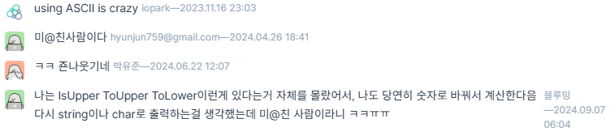

---
categories:
  - "`문자열`"
  - "`대소문자 변환`"
date: 2026-10-23
---

해결 문제 이름 : 대소문자 바꿔서 출력하기 <br>
[[문제 보러가기]](https://school.programmers.co.kr/learn/courses/30/lessons/181949)

## [문제]

영어 알파벳으로 이루어진 문자열 str이 주어집니다. 각 알파벳을 대문자는 소문자로 소문자는 대문자로 변환해서 출력하는 코드를 작성해 보세요.

```csharp
static void Main()
{
    String s;

    StringBuilder sb = new StringBuilder();
    s = Console.ReadLine()!;

    for (int i = 0; i < s.Length; i++)
    {
        if (s[i] > 90) sb.Append((char)(s[i] - 32));
        else sb.Append((char)(s[i] + 32));
    }

    Console.WriteLine(sb);
}
```

## [문제 해결 과정]

※ 문제를 해결하는데 어떤 사고 과정을 거쳤는지, 어떤 자료구조 알고리즘을 왜 선택했는지 등 구체적인 근거를 설명할 수 있어야 함

1. 문자열 입력을 받음
2. 반전시킨 문자열을 담을 StringBuilder `sb`선언 및 초기화
3. 입력의 각 문자를 순회하며 아스키 코드 값을 90 기준으로 더하거나 빼며 대소문자 반전 후 `sb`에 담음
4. `sb` 출력

## [후기]

풀이시간 : 10분 20초  
오랜만에 아스키 코드표를 찾아봤다..

다른 사람들의 풀이를 보니 내 풀이 방법은 재밌는방법에 속하는 듯 하다. 아니 `char.IsUpper()`, `char.ToUpper()`같은 함수 있는거 알았으면 나도 그거 썼지...\
\
편하게 해결할 방법을 나처럼 몰랐던 다른 사람도 있다...

32값은 `'a' - 'A'`를 통해서 offset을 얻어서 하면 기억할 필요가 없을 듯 하다.

string 변수는 `+=`을 통해 문자를 더해주면 기존 문자열을 복사하는 비용이 생긴다고 한다. 추후에 string과 StringBuilder의 기능과 성능을 비교하는 공부를 하면 좋을 것 같다. + `char[]`

또 char 타입에 대해 공부할 때 문자 집합과 어떤 연관이 있는지와 연산을 통해 어떤식으로 타입이 바뀌는지, 변환을 어떻게 하는지를 공부해야겠다.
