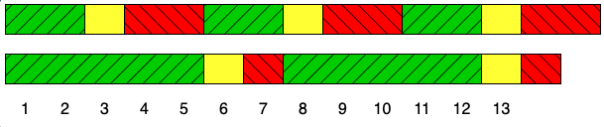

---
categories:
  - "`완전 탐색`"
  - "`신호등`"
date: 2026-10-31
---

해결 문제 이름 : 노란불 신호등<br>
[[문제 보러가기]](https://school.programmers.co.kr/learn/courses/30/lessons/468371)

## [문제]

어떤 도로에 차량 신호등이 n개 있습니다. 모든 신호등은 항상 초록불 → 노란불 → 빨간불 순서로 반복되며, 각 신호의 지속 시간은 신호등마다 다릅니다. 시간은 1초부터 시작하며, 각 신호등은 처음에는 초록불 상태로 시작합니다.

이 도로에서는 가끔 정전이 일어나는데, 모든 신호등이 모두 노란불이 되면 정전이 발생한다는 사실이 밝혀졌습니다.

예를 들어 신호등이 2개이고, 각 신호등의 주기가 다음과 같다고 가정해 보겠습니다.

| 신호등 | 초록불 | 노란불 | 빨간불 |
| ------ | ------ | ------ | ------ |
| 1번    | 2초    | 1초    | 2초    |
| 2번    | 5초    | 1초    | 1초    |



위 그림과 같이 13초에 처음으로 두 신호등이 모두 노란불이 됩니다.

신호등 n개의 신호 주기를 담은 2차원 정수 배열 signals가 매개변수로 주어집니다. 모든 신호등이 노란불이 되는 가장 빠른 시각(초)을 return 하도록 solution 함수를 완성해 주세요. 만약 모든 신호등이 노란불이 되는 경우가 존재하지 않는다면 -1을 return 해주세요.

## [해결 코드]

```csharp
public int solution(int[,] signals)
{
    // 무엇을 구해야 하냐 : 노란색이 겹치는 시기(안겹칠 수도 있음)
    // 안겹치는 조건 : 각 신호등의 G+Y+R의 값들의 곱을 넘도록 반복해도 결과가 나오지 않는 경우

    int gdc = 1;
    int[] signalSum = new int[signals.GetLength(0)];
    for(int i = 0; i < signals.GetLength(0); i++)
    {
        signalSum[i] = signals[i,0] + signals[i,1] + signals[i,2];
        gdc *= signalSum[i];
    }

    for(int m = 0; m < gdc; m++)
    {
        bool find = true;
        for(int c = 0; c < signals.GetLength(0); c++)
        {
            int scope = m % signalSum[c];
            if(!(scope > signals[c,0]) || !(scope <= signals[c, 0] + signals[c,1]))
            {
                find = false;
                break;
            }
        }
        if(find) return m;
    }
    return -1;
}
```

## [문제 해결 과정]

※ 문제를 해결하는데 어떤 사고 과정을 거쳤는지, 어떤 자료구조 알고리즘을 왜 선택했는지 등 구체적인 근거를 설명할 수 있어야 함

안 겹치는 조건을 먼저 생각했음. 신호등의 신호 주기의 합들을 모두 곱한 값을 구해놓고, 신호등을 초 단위로 검사해서 초가 곱의 값을 넘으면 반복이기에 겹치는 시기가 없다고 판단함.

앞서 for문을 통해 신호 주기 합들의 곱과 각 신호등의 신호 주기 초를 계산함. (이후 연산에 사용하기 위함)

이후 for문을 통해 초단위(`m`)로 검사함. 찾으면 그 즉시 해당 '초'를 반환하도록 하였음.

이중 포문 안에서는 각 신호등마다 현재 노란색 신호인지를 검사함. 현재초를 신호주기로 나눈 나머지로 현재 노란색 신호 범위에 있는지 검사하는 값(`scope`)으로 계산함. 만약에 현재 범위가 아니면 그 즉시 현재 초가 아님을 `find`에 표기하고 계산을 멈추고 다음 초로 넘어감

## [후기]

풀이시간 : 33분 20초

다른사람들도 나와 비슷비슷하게 풀었다. 일단 문제를 정의하고 어떻게 풀어야 할지 각 단계로 문제를 작게 나눈다음에 해당 단계를 어떤 문법에 대입하여 해결할지를 선택하는 것이 중요하다는 것을 깨달았다.
