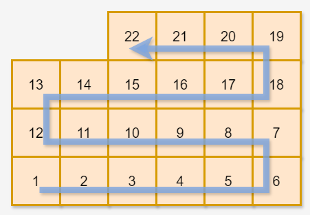

해결 문제 이름 : 택배 상자 꺼내기 <br>
[[문제 보러가기]](https://school.programmers.co.kr/learn/courses/30/lessons/389478)

## [문제]
1 ~ n의 번호가 있는 택배 상자가 창고에 있습니다. 당신은 택배 상자들을 다음과 같이 정리했습니다.

왼쪽에서 오른쪽으로 가면서 1번 상자부터 번호 순서대로 택배 상자를 한 개씩 놓습니다. 가로로 택배 상자를 w개 놓았다면 이번에는 오른쪽에서 왼쪽으로 가면서 그 위층에 택배 상자를 한 개씩 놓습니다. 그 층에 상자를 w개 놓아 가장 왼쪽으로 돌아왔다면 또다시 왼쪽에서 오른쪽으로 가면서 그 위층에 상자를 놓습니다. 이러한 방식으로 n개의 택배 상자를 모두 놓을 때까지 한 층에 w개씩 상자를 쌓습니다.



 - 위 그림은 w = 6일 때 택배 상자 22개를 쌓은 예시입니다.

다음 날 손님은 자신의 택배를 찾으러 창고에 왔습니다. 당신은 손님이 자신의 택배 상자 번호를 말하면 해당 택배 상자를 꺼내줍니다. 택배 상자 A를 꺼내려면 먼저 A 위에 있는 다른 모든 상자를 꺼내야 A를 꺼낼 수 있습니다. 예를 들어, 위 그림에서 8번 상자를 꺼내려면 먼저 20번, 17번 상자를 꺼내야 합니다.

당신은 꺼내려는 상자 번호가 주어졌을 때, 꺼내려는 상자를 포함해 총 몇 개의 택배 상자를 꺼내야 하는지 알고 싶습니다.

창고에 있는 택배 상자의 개수를 나타내는 정수 n, 가로로 놓는 상자의 개수를 나타내는 정수 w와 꺼내려는 택배 상자의 번호를 나타내는 정수 num이 매개변수로 주어집니다. 이때, 꺼내야 하는 상자의 총개수를 return 하도록 solution 함수를 완성해 주세요.

## [해결 코드]
```csharp
public int solution(int n, int w, int num) 
{
    // 목표 : 상자를 꺼낼 때 몇개를 꺼내야 하는지 반환하기
    // 1. 상자를 이중 배열로 쌓는다.
    // 2. 꺼내려는 상자의 배열 위치를 찾는다.
    // 3. 해당 위치로부터 몇개를 꺼내야 하는지 반복 검사를 한다.(0을 만나면 break;)
    
    int h = (n-1) / w;
    int[,] boxes = new int[h+1, w];
    for(int count = 0; count < n; count++)
    {
        int height = count / w;
        int wIndex = height % 2 == 0 ? count % w : (w-1) - count % w;
        boxes[height, wIndex] = count+1;
    }
    
    int numh = (num - 1) / w;
    int numw = numh % 2 == 0 ? (num -1) % w : (w-1) - (num - 1) % w;
    
    int outCount = 0;
    for(int fh = numh; fh <= h; fh++)
    {
        if(boxes[fh, numw] != 0)
        {
            outCount++;
        }
        else
        {
            break;
        }
    }
    return outCount;
}
```

## [문제 해결 과정]
 ※ 문제를 해결하는데 어떤 사고 과정을 거쳤는지, 어떤 자료구조 알고리즘을 왜 선택했는지 등 구체적인 근거를 설명할 수 있어야 함

- 이차원 배열로 박스를 쌓기로 하였다.
- `% 2` 연산으로 우측부터 쌓을지 좌측부터 쌓을지를 결정하였다.
- 배열이 0으로 초기화되는 것을 이용하여 특정 박스 위치부터 위로 이동하면서 0이 아니면 `outCount`를 증가시켜 몇개의 박스를 꺼냈는지 확인하였다.

## [후기]
풀이시간 : 33분 33초

인덱스 개념이 엄청 헷갈렸다. 배열은 인덱싱이 0부터 시작하지만 박스는 1부터 쌓기 시작했고 for문을 돌거나 위치를 계산하는데도 많이 헷갈려했다.

이런 인덱스 개념을 좀 강화할 필요가 있어보인다.

다른 사람은 규칙을 찾아서 반복문을 통해 해결하였다.
```csharp
int answer = 0;
while (num<=n)
{
    num += 2 * (w - ((num - 1) % w) - 1) + 1;
    answer++;
}
return answer;
```
다음에 쌓일 박스의 수를 2배로 해서 위에 있는 박스의 위치를 계산하는 방식이다. 생각의 발상이 다르다..

문제를 나누는 방식의 차이가 아니라 무엇을 계산 대상으로 삼았느냐의 차이인듯 하다.

답을 구하는데 있어서 필요한 계산만 하는 연습이 필요하다.
내 방식이 틀린건 아니지만 불필요한 구현이 있다.