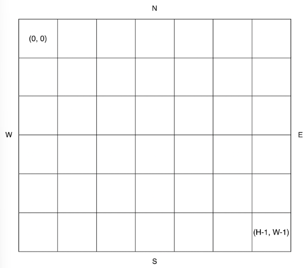

---
categories:
- "`배열`"
- "`방향`"
date: 2026-11-03
---

해결 문제 이름 : 공원 산책 <br>
[[문제 보러가기]](https://school.programmers.co.kr/learn/courses/30/lessons/172928)

## [문제]

지나다니는 길을 'O', 장애물을 'X'로 나타낸 직사각형 격자 모양의 공원에서 로봇 강아지가 산책을 하려합니다. 산책은 로봇 강아지에 미리 입력된 명령에 따라 진행하며, 명령은 다음과 같은 형식으로 주어집니다.

- ["방향 거리", "방향 거리" … ]

예를 들어 "E 5"는 로봇 강아지가 현재 위치에서 동쪽으로 5칸 이동했다는 의미입니다. 로봇 강아지는 명령을 수행하기 전에 다음 두 가지를 먼저 확인합니다.

- 주어진 방향으로 이동할 때 공원을 벗어나는지 확인합니다.
- 주어진 방향으로 이동 중 장애물을 만나는지 확인합니다.

위 두 가지중 어느 하나라도 해당된다면, 로봇 강아지는 해당 명령을 무시하고 다음 명령을 수행합니다.
공원의 가로 길이가 W, 세로 길이가 H라고 할 때, 공원의 좌측 상단의 좌표는 (0, 0), 우측 하단의 좌표는 (H - 1, W - 1) 입니다.



공원을 나타내는 문자열 배열 park, 로봇 강아지가 수행할 명령이 담긴 문자열 배열 routes가 매개변수로 주어질 때, 로봇 강아지가 모든 명령을 수행 후 놓인 위치를 [세로 방향 좌표, 가로 방향 좌표] 순으로 배열에 담아 return 하도록 solution 함수를 완성해주세요.

## [해결 코드]

```csharp
public int[] solution(string[] park, string[] routes)
{
    int h = park.Length;
    int w = park[0].Length;
    int[] curPos = new int[2];
    bool[,] parkArr = new bool[h,w];

    for(int height = 0; height < h; height++)
    {
        for(int width = 0; width < w; width++)
        {
            bool isObstacle = false;
            char posChar = park[height][width];
            switch (posChar)
            {
                case 'X': isObstacle = true; break;
                case 'S': curPos[0] = height; curPos[1] = width; break;
            }
            parkArr[height,width] = isObstacle;
        }
    }

    for(int rc = 0; rc < routes.Length; rc++)
    {
        string[] route = routes[rc].Split(' ');
        int distance = int.Parse(route[1]);
        int[] move = new int[2] {0,0};
        switch(route[0])
        {
            case "N": move[0] = -1 * distance; break;
            case "S": move[0] = distance; break;
            case "W": move[1] = -1 * distance; break;
            case "E": move[1] = distance; break;
        }
        move[0] += curPos[0];
        move[1] += curPos[1];

        bool outHeight = move[0] < 0 || move[0] >= h;
        bool outWidth = move[1] < 0 || move[1] >= w;
        if(outHeight||outWidth) continue;

        int toPurpose = 1;
        bool isObstacle = false;
        while(toPurpose <= distance)
        {
            int ph = move[0] - curPos[0];
            ph = ph == 0 ? 0 : ph / distance * toPurpose;
            int pw = move[1] - curPos[1];
            pw = pw == 0 ? 0 : pw / distance * toPurpose;

            toPurpose++;

            if(parkArr[curPos[0]+ph,curPos[1] + pw] == true)
            {
                isObstacle = true;
                break;
            }
        }
        if(isObstacle == false) curPos = move;
    }

    return curPos;
}
```

## [문제 해결 과정]

※ 문제를 해결하는데 어떤 사고 과정을 거쳤는지, 어떤 자료구조 알고리즘을 왜 선택했는지 등 구체적인 근거를 설명할 수 있어야 함

목표 : 루트의 명령대로 이동한 후의 최종 위치 좌표

최종 위치 좌표를 알려면 뭘 어떻게 해야 하지?

- 시작 위치에서
- 루트대로 다 움직여봐야 함
  - 움직이지 않고는 알 수 없나?
- 루트대로 움직이려면 어떤 것이 필요하지?
  - 시작 위치, 장애물 위치(움직이지 않는 조건1)가 담긴 2차원 배열
  - 2차원 배열의 가로, 세로 길이 (움직이지 않는 조건 2)
  - 루트를 해석하여 적용할 수 있어야 함
- 움직이는 것은 어떤 로직으로 표현하지?
  - 루트 해석
  - 먼저 범위를 벗어나지 않는지 확인
  - 장애물이 그 사이에 있는지 확인
  - 현재 위치(변수) 갱신
- 루트 해석은 어떻게 표현하지?
  - switch나 if문으로 일일히 로직 설계 (가로세로 + 이동 값으로 방향과 거리 표현) => 빠른 설계, 로직량 늘어남, 가독성은 별로
  - 어차피 한방향으로만 움직인다. 배열을 벗어나지 않았는지와 그 사이 장애물만 확인하면 된다.
    - 예상 도착 위치 계산
    - 벗어났는지를 0과 h, w로 계산
    - 그 사이를 인덱스로 2차원 배열을 확인하여 장애물 확인
      - 가로 세로 둘다 인덱스를 목표 방향으로 1씩 늘려가며 계산
    - 현재 위치 갱신

## [후기]

풀이시간 : 1시간 30분

너무 단계를 쪼개려고 해도 안되겠다고 느꼈다. 어떤 것은 같이 조합해서 풀어야 하는 경우도 있다는 것을 생각했다.

각 루트를 계산할때 다음 처럼 순서를 잡았었다.

- 이동할 거리를 int[]로 먼저 계산
- park범위를 벗어나지 않는지 계산
- 현재 위치에서 목표 위치까지 장애물이 없는지 계산

이렇게 하려 했는데 3번재 계산에서 어느방향으로 움직여야할지가 추가로 필요해졌다. 그걸 1번 계산에서 다 해버리는데 정작 3번째 계산에서 그 계산이 다시 필요해졌다.

원본 데이터로 필요한 판단을 바로 할 수 있다면 추가 변환은 생략할 수 있다. 또한 단계를 나누는 것뿐 아니라, 각 단계에서 필요한 정보를 재사용하기 쉬운 형태로 표현하고 변수의 의미를 일관되게 유지하는 것이 중요하다는 것을 배웠다.